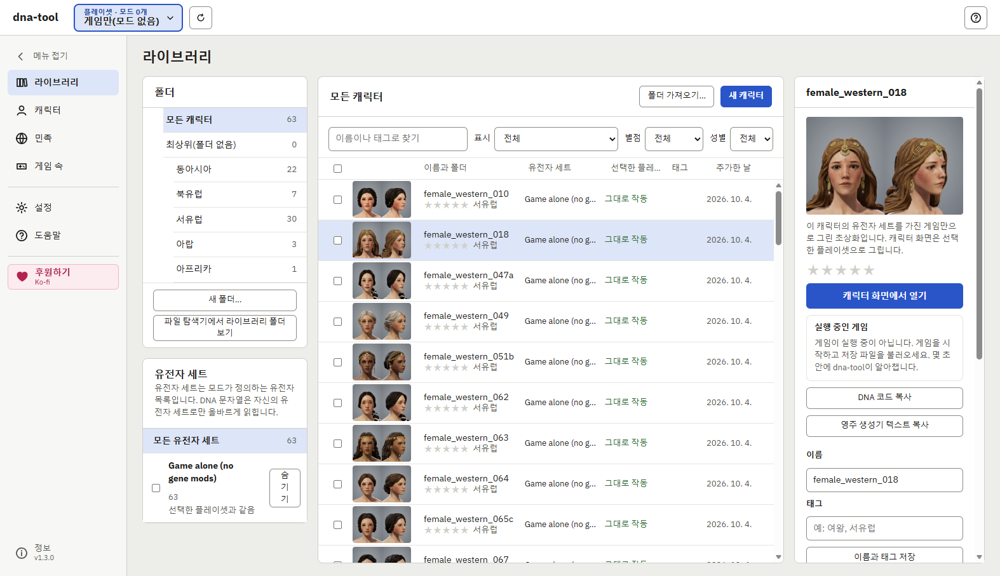
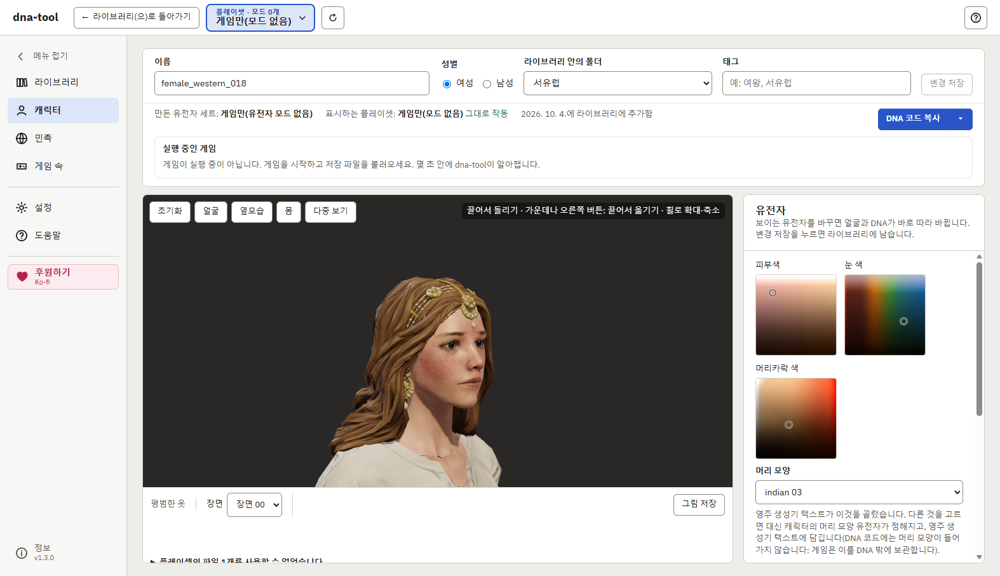
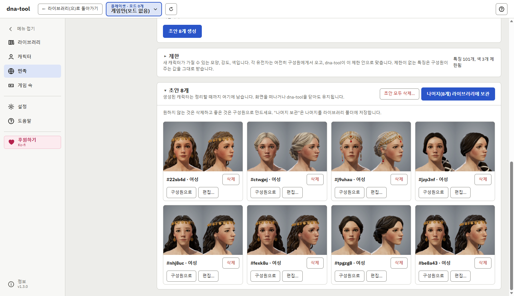
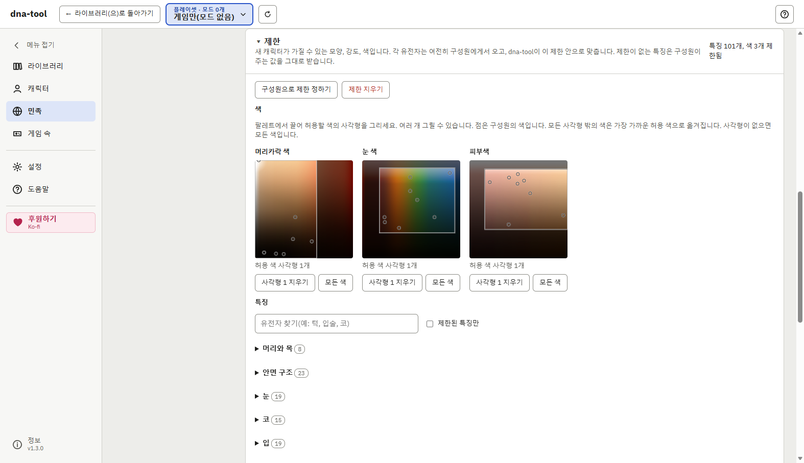
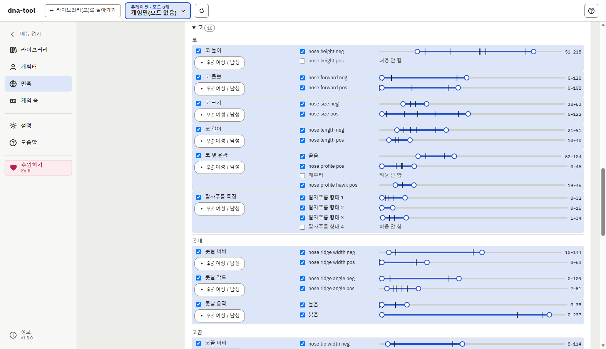
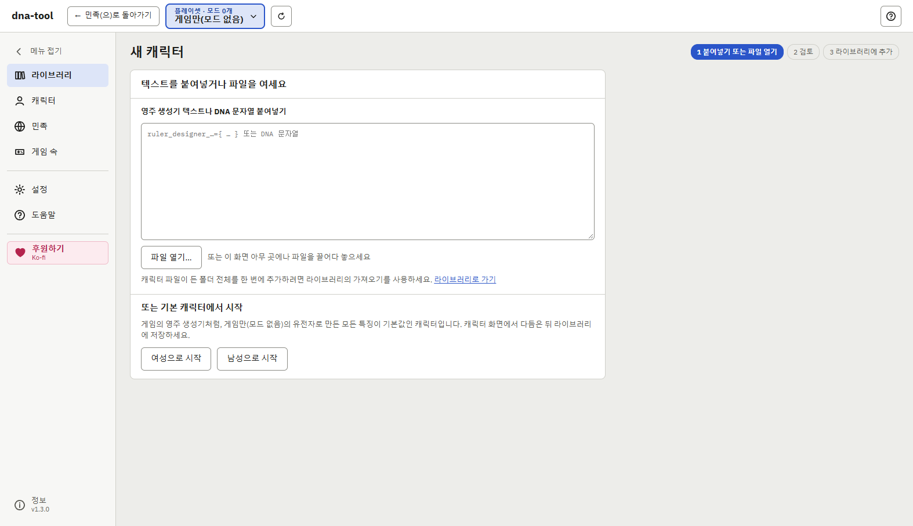
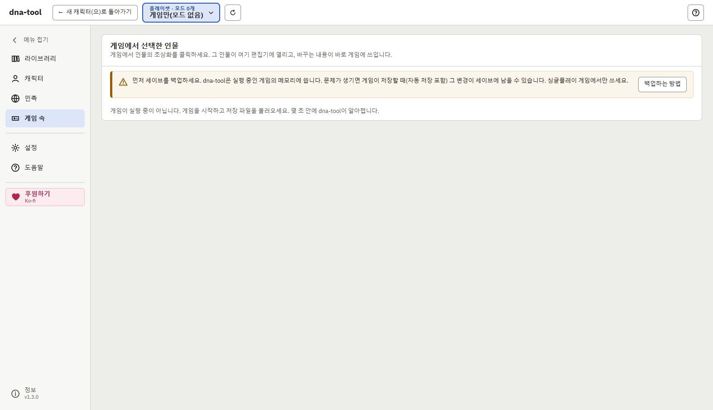
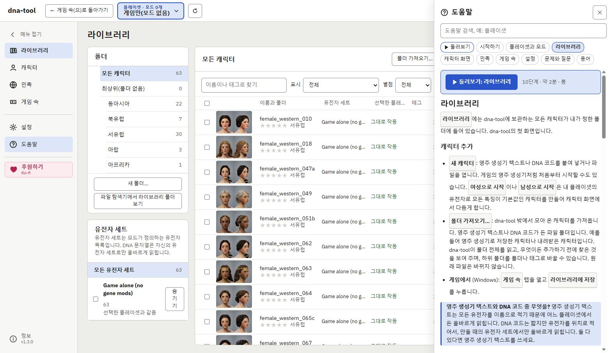

# 크루세이더 킹즈 3용 dna-tool

[English](README.md) | 한국어

크루세이더 킹즈 3 캐릭터의 외모(DNA)를 다루는 무료 Windows 프로그램입니다. 캐릭터를 3D 미리보기와
초상화가 있는 라이브러리에 모아 두고, 유전자를 고치고, 비슷한 얼굴 묶음에서 새 캐릭터를 만들고,
다른 모드로 만든 캐릭터를 내 플레이셋으로 가져오고, 실행 중인 게임의 캐릭터에게 라이브러리
캐릭터의 외모를 줄 수 있습니다.

내 게임과 내 플레이셋 그대로 동작합니다. 게임과 모드의 파일을 읽어서 내 플레이셋에서 보이는
그대로 캐릭터를 보여 줍니다. 모든 것이 내 PC에서만 이루어집니다. 계정도, 업로드도 없고, 게임
파일을 바꾸지 않습니다.

**[최신 버전 내려받기](https://github.com/whitenameb-dev/ck3-dna-tool/releases/latest)**

## 할 수 있는 것

- **라이브러리**: 영주 생성기 텍스트나 DNA 코드로 캐릭터를 추가합니다(붙여 넣기, 파일, 폴더째).
  폴더, 태그, 별점, 필터, 검색으로 정리합니다. 여러 캐릭터에 한 번에: 유전자 설정(예: "남성: 대머리
  아님"), 다른 플레이셋의 유전자나 다른 성별로 변환, 텍스트 파일 하나로 모두 내려받기.
- **초상화 자동 생성**: 라이브러리의 모든 캐릭터마다 초상화(정면과 45도)를 dna-tool이 알아서 그려
  둡니다. 수백 명이어도 일일이 열어 보지 않고 목록에서 얼굴로 고를 수 있습니다. 캐릭터를 바꾸면
  초상화도 새로 그립니다.
- **캐릭터 화면**: 내 플레이셋의 모델과 텍스처(머리, 머리카락, 몸, 옷)로 그린 3D 미리보기, 모든
  유전자의 슬라이더, 색, 머리 모양. **다중 보기**로 세 각도를 한 번에 보고, **그림 저장**으로
  미리보기를 이미지로 저장합니다. 결과는 영주 생성기 텍스트나 DNA 코드로 복사합니다.
- **다른 모드, 다른 플레이셋의 캐릭터**: 다른 모드 구성으로 만든 DNA를 가져와 내 플레이셋에서
  씁니다(아래 참고).
- **민족**: 마음에 드는 캐릭터를 묶어, 그 유전자로 새 캐릭터를 만듭니다. 특징, 색, 성별마다 제한을
  걸 수 있습니다(아래 참고).
- **게임 속**: 실행 중인 게임에서 선택한 캐릭터에게 라이브러리 캐릭터의 외모를 주거나, 그 캐릭터를
  편집기에서 열어 실시간으로 바꾸고 라이브러리에 저장합니다.
- **프로그램 안의 도움말**: 화면마다 도움말 페이지(F1, 또는 오른쪽 위의 **?**)와 짧은 둘러보기가
  있습니다.
- 영어와 한국어.

## 다른 모드, 다른 플레이셋의 캐릭터

모드는 어떤 유전자가 있는지를 바꿉니다. **DNA 코드**는 유전자를 위치로 적어서, 만들 때의 모드
유전자로만 올바르게 읽힙니다. 다른 플레이셋에 그대로 넣으면 특징이 엉뚱한 유전자로 옮겨져 얼굴이
바뀝니다. **영주 생성기 텍스트**는 모든 유전자를 이름으로 적어서 어느 플레이셋에서든 읽힙니다
(내 플레이셋에 없는 유전자는 빠집니다).

dna-tool이 이것을 대신 챙깁니다.

- 캐릭터마다 **유전자 세트**를 기억합니다. 만들 때 쓴 모드의 유전자입니다(예: "EPE + CFP, game
  1.20").
- 라이브러리와 캐릭터 화면에서 캐릭터가 내 플레이셋에서 그대로 작동하는지, 어떤 유전자가 다르게
  읽히는지 알려 줍니다.
- **변환…**은 다른 유전자 세트, 다른 성별, 또는 둘 다에 맞는 사본을 만듭니다. 유전자를 이름으로
  맞추고, 무엇이든 하기 전에 바뀌는 것을 모두 보여 줍니다. 여러 캐릭터를 한 번에 변환할 수 있습니다.
- 모드 업데이트로 유전자 파일이 바뀌면, 내 DNA 코드가 똑같이 읽히는지 알려 줍니다.

그래서 바닐라, EPE, CFP 등 다른 구성으로 만든 캐릭터를 내 플레이셋에 맞게 변환한 뒤, 영주 생성기에
붙여 넣거나 실행 중인 게임의 캐릭터에게 줄 수 있습니다.

## 민족: 마음에 드는 얼굴들로 새 얼굴 만들기

dna-tool의 **민족**은 원하는 모습을 정하는 라이브러리 캐릭터 묶음입니다. 게임의 민족 파일을 만들거나
바꾸는 기능이 아니라, 그 묶음으로 **새 캐릭터를 원하는 만큼** 만들어 주는 기능입니다. 왕비 후보
여러 명, 닮은 왕조 가족, 내 나라 사람처럼 보이는 얼굴들이 필요할 때 씁니다.

1. **구성원 고르기**: 라이브러리에서 캐릭터를 2명 이상 체크하고 **이 캐릭터로 민족 만들기**를
   누릅니다.
2. **만들기**: 몇 명, 성별, 나이를 정하고 **초안 N개 생성**을 누릅니다. 특징(코, 눈, 턱…)마다
   구성원 중 한 명에게서 무작위로 가져오고, 변화량만큼 조금씩 달라집니다. 섞는 단위를 **얼굴
   부위**로 하면 코 전체, 눈 전체처럼 부위를 한 사람에게서 통째로 가져와 더 자연스러울 때가
   많습니다.
3. **초안 고르기**: 새 캐릭터는 초상화가 붙은 초안으로 나옵니다. 마음에 드는 것은 라이브러리에
   보관하거나 **구성원으로** 더하고, 캐릭터 화면에서 먼저 다듬거나, 나머지는 지웁니다.

**제한**으로 결과를 조종합니다. 제한이 없으면 새 캐릭터는 구성원들이 가진 것 무엇이든 받을 수
있습니다.

- **특징**: 특징마다 허용할 형태와 강도 범위를 정합니다(예: 매부리코 금지, 턱 너비는 이 범위만).
- **색**: 피부, 눈, 머리카락 팔레트 위에 허용할 색 영역을 사각형으로 그립니다(예: 금발과 밝은
  갈색 머리만).
- **여성과 남성**: 같은 특징을 성별마다 다르게 정합니다(예: 남성만 턱을 더 넓게).
- 시작은 **구성원으로 제한 정하기**입니다. 지금 구성원들이 가진 범위로 모든 것을 제한한 뒤, 넓히거나
  좁힙니다.
- **시드 고정**을 켜면 같은 캐릭터를 다시 만들어, 제한을 바꾸기 전과 후를 비교할 수 있습니다.

## 지원 환경

- **Windows** 10 또는 11, 64비트. Linux와 macOS용은 아직 없습니다.
- **Steam판 크루세이더 킹즈 3**: 게임, 창작마당 모드, 런처의 플레이셋을 dna-tool이 스스로 찾습니다.
  다른 곳에서 산 게임은 아직 시험하지 않았습니다. 설정에서 게임 폴더를 직접 고르면 동작할 수도
  있습니다([Issues](https://github.com/whitenameb-dev/ck3-dna-tool/issues)에 알려 주세요).
- **게임 버전 1.20.** 라이브러리, 미리보기, 유전자 편집, 민족, 변환은 게임과 모드의 파일을 그대로
  읽어서 게임 버전에 크게 묶이지 않습니다.
- **게임 속 탭**은 게임 1.20 버전용입니다(1.20.0.4에서 확인). 새 게임 버전에서는 dna-tool이
  업데이트될 때까지 동작하지 않을 수 있고, 나머지 기능은 그대로 동작합니다.
- **모드**: 창작마당 모드와 런처의 로컬 모드(`mod` 폴더).

## 설치

`dna-tool-<버전>-portable.exe`를 내려받아 실행하세요. 설치 과정은 없습니다. 파일을 아무 곳(예:
바탕 화면이나 프로그램 폴더)에 두고, 원하면 바로 가기를 만드세요. 업데이트할 때는 새 버전을 받고
이전 파일을 지우면 됩니다. 라이브러리는 그대로 남습니다.

dna-tool은 새 프로그램이고 아직 코드 서명이 없어서 Windows가 경고합니다. 평판에 관한 경고이지
바이러스를 찾았다는 뜻이 아닙니다(Microsoft Defender는 그대로 파일을 검사합니다).

- **Edge**가 "일반적으로 다운로드되지 않는" 파일이라고 하면: **⋯**, **유지**, **자세히 표시**,
  **그래도 계속**을 차례로 고르세요.
- 실행할 때 **Windows**가 "Windows의 PC 보호"를 띄우면: **추가 정보**, **실행**을 고르세요.

내려받은 파일을 확인하려면 SHA-256 해시(PowerShell에서 `Get-FileHash <파일>`)를 같은 릴리스의
`SHA256SUMS.txt`와 비교하세요.

1.1.1까지의 버전은 설치 프로그램(`-setup.exe`)으로도 나왔습니다. 설치했었다면 Windows의 **설정 >
앱**에서 제거할 수 있고, 설정과 라이브러리는 그대로 남습니다.

## 처음 쓸 때

1. 처음 시작하면 dna-tool이 게임과 플레이셋을 찾고, 런처의 플레이셋 목록을 읽기 전에 허락을
   구합니다.
2. 왼쪽 위 상자에서 실제로 플레이하는 플레이셋을 고릅니다.
3. **라이브러리**에서 **새 캐릭터**를 누르고 캐릭터의 영주 생성기 텍스트나 DNA 코드를 붙여 넣거나
   파일을 엽니다. 캐릭터가 아직 없다면 **여성으로 시작**이나 **남성으로 시작**으로 게임의 영주
   생성기처럼 모든 특징이 기본값인 캐릭터에서 시작합니다. 다른 곳에서 모아 둔 캐릭터는 **폴더
   가져오기…**로 한 번에 넣습니다.
4. 게임에서 쓰려면 캐릭터 화면에서 **영주 생성기 텍스트 복사**를 누르고 게임의 영주 생성기에 붙여
   넣으세요. 영주 생성기는 DNA 코드를 받지 않습니다(DNA 코드는 게임의 디버그 모드 초상화 편집기와
   DNA 코드를 받는 도구용입니다).

## 게임 속 탭에 대해

> **먼저 세이브를 백업하세요.** 게임 속 탭은 실행 중인 게임의 메모리를 바꿉니다. 문제가 생기면
> (잘못된 캐릭터, 게임 멈춤, dna-tool이 아직 모르는 게임 업데이트) 게임이 저장할 때(자동 저장
> 포함) 그 변경이 세이브에 남을 수 있습니다. 문서 폴더 안의 게임 `save games` 폴더에서 플레이 중인
> 세이브를 복사하거나, 게임에서 새 이름으로 저장하세요.

게임에서 선택한 캐릭터를 보여 주고 바꾸기 위해 dna-tool의 도우미(`game-link.exe`)가 실행 중인
게임의 메모리를 읽고 씁니다. 선택한 캐릭터의 외모만 다루고, 세이브 파일이나 게임 파일은 절대 바꾸지
않으며, 게임의 코드도 바꾸지 않습니다. 게임 속 탭이나 "…에게 이 외모 주기"를 쓰는 동안에만
실행되고, dna-tool과만 통신하며(네트워크 없음), dna-tool을 닫으면 함께 닫힙니다.

> **백신 경고.** `game-link.exe`는 아직 코드 서명이 없고, 다른 프로그램(게임)을 열어 메모리를 읽고
> 씁니다. 게임 트레이너와 일부 악성 프로그램도 같은 일을 해서, 백신이 경고하거나 막거나 격리할 수
> 있습니다. 묻지 않고 그럴 때도 있습니다.
>
> - 격리되면 게임 속 탭만 동작하지 않고, 나머지는 그대로 동작합니다.
> - 그래도 게임 속 탭을 쓰려면: 먼저 같은 릴리스의 `SHA256SUMS.txt`로 내려받은 파일을 확인한 뒤,
>   격리에서 파일을 복원하고 백신에서 dna-tool 포터블 exe를 허용하세요. 포터블 프로그램은 시작할
>   때마다 `game-link.exe`를 새 임시 폴더에 풀기 때문에, 그 파일 하나만 허용하면 오래가지 않습니다.
> - dna-tool은 이 저장소의 [Releases](https://github.com/whitenameb-dev/ck3-dna-tool/releases)에서만
>   받으세요. 다른 곳의 사본은 말하는 것과 다를 수 있습니다.

외모만 바꾸며, 플레이에 영향을 주는 것은 바꾸지 않습니다. **싱글플레이 게임에서만** 쓰고,
멀티플레이 게임에서는 절대 쓰지 마세요.

이렇게 바꾼 것은 다른 것과 마찬가지로 게임 상태의 일부입니다. 남기려면 게임을 저장하고, 원래 외모로
돌리려면 **…의 외모 되돌리기**를 쓰세요. 사용에 따른 책임은 본인에게 있으니, 아끼는 세이브는 복사해 두세요.

## 내 데이터

설정, 라이브러리, 캐시는 `%LOCALAPPDATA%\dna-tool`에 있습니다(라이브러리는 설정에서 다른 폴더로
옮길 수 있습니다). dna-tool 파일을 지워도 이것들은 남습니다. 함께 지우려면 이 폴더도 지우세요.

## 질문과 문제

대부분의 질문은 dna-tool 안의 도움말(F1)에 답이 있고, 문제와 질문 페이지도 있습니다.

문제는 [Issues](https://github.com/whitenameb-dev/ck3-dna-tool/issues)에 알려 주세요. 무엇을 했는지,
무슨 일이 일어났는지, 플레이셋의 유전자 모드, dna-tool 버전(메뉴 맨 아래에 나옵니다)을 적어 주세요.
한국어로 써도 됩니다. 스크린샷이 있으면 도움이 되며, 성인용 모드의 내용은 가려 주세요.

## 후원

dna-tool은 무료입니다. 쓸모가 있었다면 [Ko-fi](https://ko-fi.com/whitenameb)에서 후원할 수 있습니다.

## 라이선스

개인적, 비상업적 용도로 무료입니다. 바꾸지 않은 채로 무료로 나눌 수 있습니다.
[LICENSE](LICENSE)를 보세요. 이 저장소에는 릴리스만 있습니다.

스크린샷의 캐릭터는 게임만(모드 없음)으로 만들었고, 평범한 옷을 입고 있습니다.

dna-tool은 팬이 만든 도구입니다. Paradox Interactive가 만들거나 보증하거나 지원하지 않습니다.
Crusader Kings는 Paradox Interactive AB의 상표입니다.
