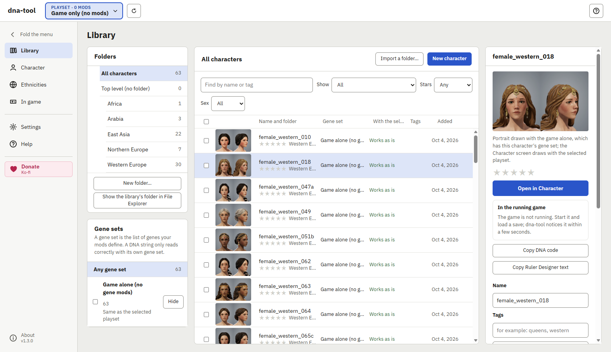
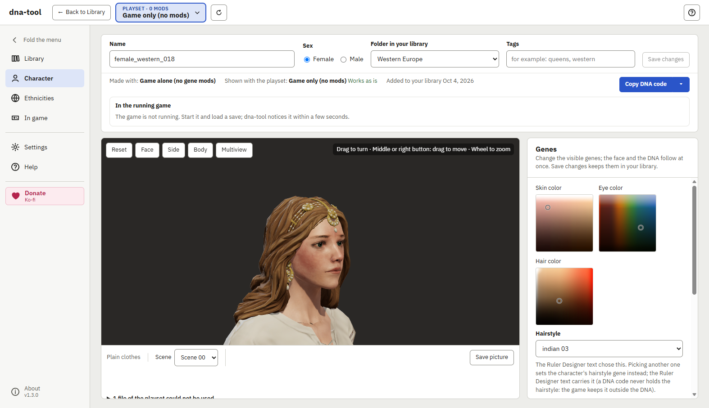
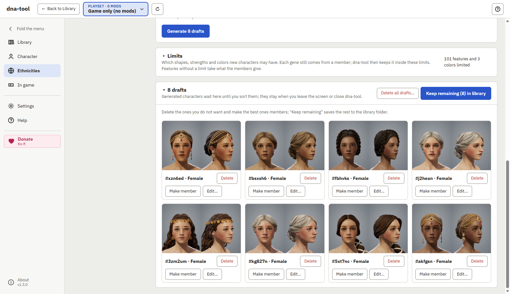
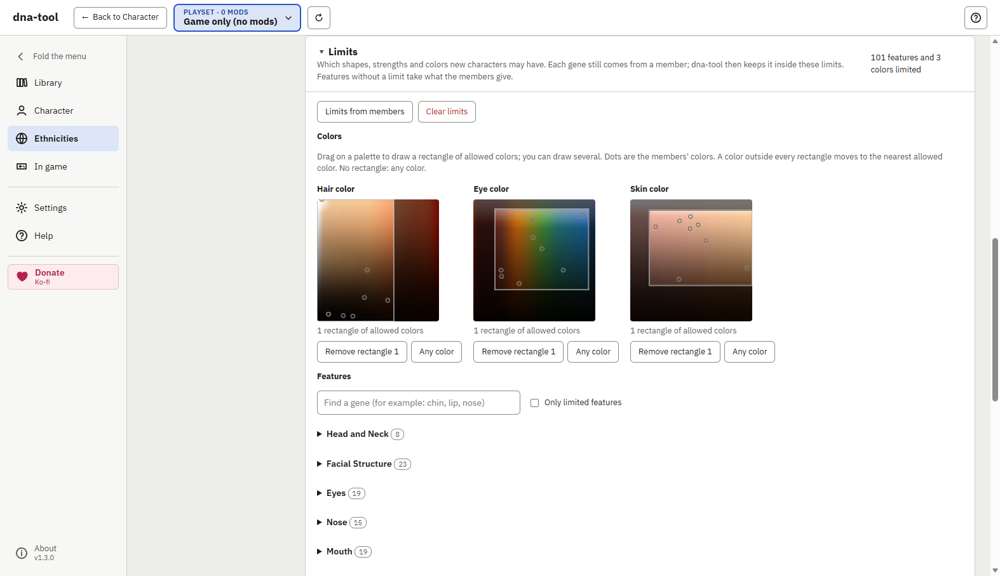
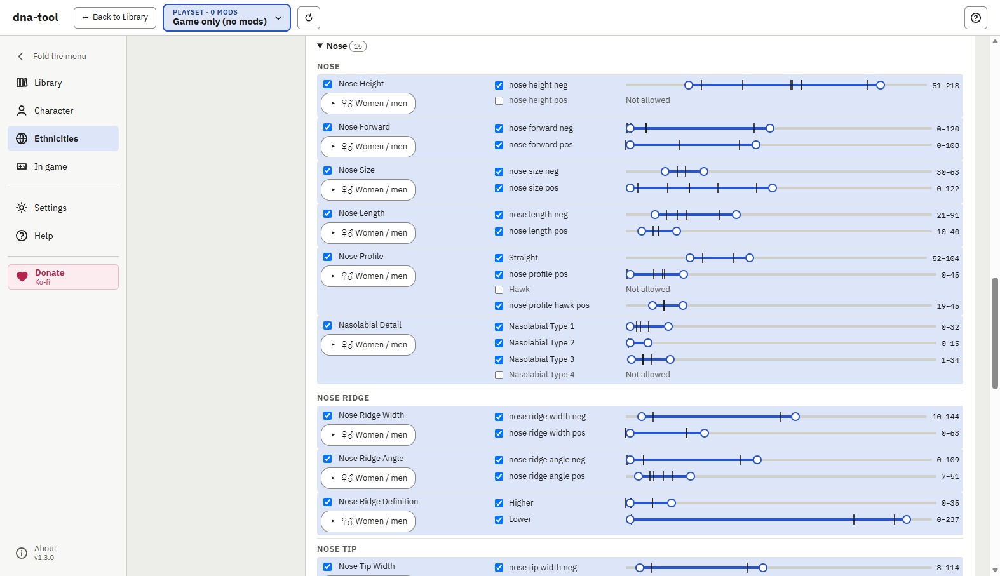
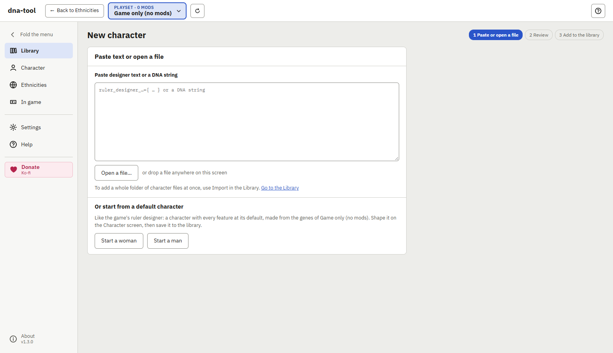
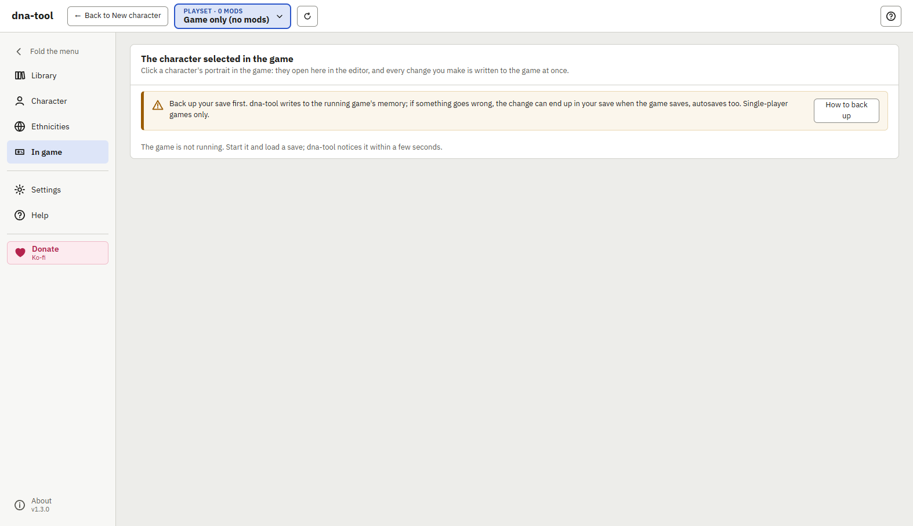
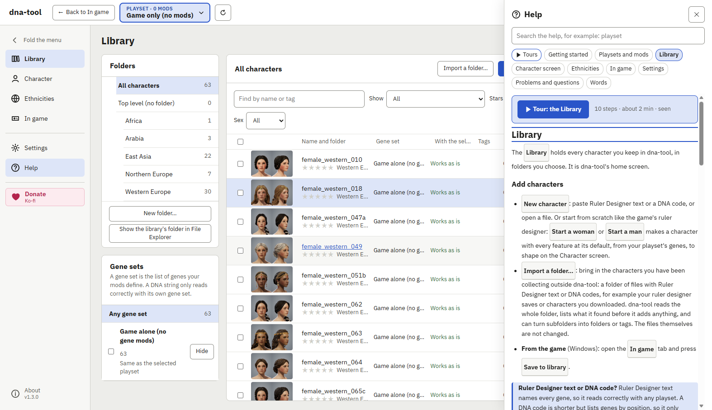

# dna-tool for Crusader Kings III

English | [한국어](README.ko.md)

A free Windows app for character appearances (DNA) in Crusader Kings III. Keep a library of
characters with 3D previews and portraits, edit their genes, make new characters from groups of
similar faces, bring characters made with other mods into your own playset, and give a character in
your running game the appearance of one from your library.

It works with your own game and your own playsets: it reads the game's and your mods' files to
show characters exactly as your playset does. Everything stays on your PC. No account, no uploads,
no game files changed.

**[Download the latest version](https://github.com/whitenameb-dev/ck3-dna-tool/releases/latest)**

## What it does

- **Library**: add characters from Ruler Designer text or DNA codes (paste, files or whole
  folders). Folders, tags, stars, filters and search. Bulk actions: set genes on many characters at
  once (for example "Men: not bald"), convert characters to another playset's genes or the other
  sex, download them all as one text file.
- **Portraits, made for you**: dna-tool draws a portrait (front and 45 degrees) of every character
  in your library, so you can choose by face even among hundreds. A changed character gets a new
  portrait.
- **Character screen**: a 3D preview with your playset's own models and textures (head, hair, body,
  clothes), every gene with its slider, colors and hairstyles. **Multiview** shows three angles at
  once; **Save picture** saves the preview as an image. Copy the result as Ruler Designer text or as
  a DNA code.
- **Characters from other mods and playsets**: bring in DNA made with other mod setups and use it
  in yours (see below).
- **Ethnicities**: group characters you like, then generate new characters from their genes, with
  limits per feature, per color and per sex (see below).
- **In game**: give the character selected in your running game a library character's appearance,
  or open that character in the editor and change it live, then save it to your library.
- **Help inside the app**: help pages for every screen (F1, or the **?** at the top right) and a
  short tour of each screen.
- English and Korean.

## Characters from other mods and playsets

Mods change which genes exist. A **DNA code** stores genes by position, so it reads correctly only
with the genes of the mods it was made with: pasted into another playset, features move to the
wrong genes and the face changes. **Ruler Designer text** names every gene, so it reads in any
playset (genes your playset lacks are left out).

dna-tool keeps track of this for you:

- Each character remembers its **gene set**: the genes of the mods it was made with (for example
  "EPE + CFP, game 1.20").
- The Library and the Character screen say whether a character works as is with your playset, and
  which genes would read differently.
- **Convert…** makes a copy for another gene set, the other sex, or both. It matches genes by name
  and shows every change before it does anything; it works on many characters at once.
- When a mod update changes its gene files, dna-tool tells you whether your DNA codes still read
  the same.

So a character made with vanilla, EPE, CFP or another setup can be converted for your playset, then
pasted into the Ruler Designer or given to a character in your running game.

## Ethnicities: new faces from faces you like

An **ethnicity** in dna-tool is a group of library characters that sets the look you want. It does
not create or change the game's ethnicity files: it makes as many **new characters** as you like
from the group. Use it for a set of queens to choose from, a dynasty that looks related, or people
who look like they belong to your realm.

1. **Choose members**: tick two or more characters in the Library and press **Make an ethnicity
   from these**.
2. **Generate**: choose how many, the sex and the age, then press **Generate … drafts**. Each feature
   (nose, eyes, jaw …) comes from one member chosen at random and moves a little by the variation.
   Mix by **Face parts** to take a whole part (the whole nose, the whole eyes) from one member, which
   often looks more natural.
3. **Sort the drafts**: new characters arrive as drafts with portraits. Keep the ones you like in
   the library (or **Make member**), edit one on the Character screen first, or delete the rest.

**Limits** steer the results; without them, a new character can get anything its members have:

- **Features**: for each feature, which shapes are allowed and the range of strengths (for example
  no hooked nose, the jaw width only within this range).
- **Colors**: draw rectangles on the skin, eye and hair palettes for the colors you allow (for
  example blond and light brown hair only).
- **Women and men**: set a feature differently for each sex (for example wider jaws for men only).
- **Limits from members** is the place to start: everything is limited to what the members have now;
  then widen or narrow it.
- **Use a fixed seed** makes the same characters again, so you can compare before and after a
  change of limits.

## Supported

- **Windows** 10 or 11, 64-bit. There are no Linux or macOS builds yet.
- **Crusader Kings III from Steam**: dna-tool finds the game, the Steam Workshop mods and the
  launcher's playsets by itself. Copies of the game from other stores have not been tried; choosing
  the game folder in Settings may work (tell us in [Issues](https://github.com/whitenameb-dev/ck3-dna-tool/issues)).
- **Game version 1.20.** The library, previews, gene editing, ethnicities and converting read the
  game's and your mods' own files, so they are not tied closely to one game version.
- **The In game tab** is made for game version 1.20 (checked on 1.20.0.4). A new game version can
  stop it working until dna-tool is updated; the rest of dna-tool keeps working.
- **Mods**: Steam Workshop mods and the launcher's local mods (the `mod` folder).

## Install

Download `dna-tool-<version>-portable.exe` and run it. There is nothing to install: keep the file
anywhere (for example your Desktop or a Programs folder) and make a shortcut to it if you like. To
update, download the new version and delete the old file; your library stays.

dna-tool is new and not code-signed yet, so Windows warns about it. That is about its reputation,
not a virus finding (Microsoft Defender still scans the file):

- **Edge** may say the file "isn't commonly downloaded": choose **⋯**, then **Keep**, then
  **Show more**, then **Keep anyway**.
- **Windows** may show "Windows protected your PC" when you start it: choose **More info**, then
  **Run anyway**.

To check your download, compare its SHA-256 hash (`Get-FileHash <file>` in PowerShell) with
`SHA256SUMS.txt` in the same release.

Versions up to 1.1.1 also came as an installer (`-setup.exe`). If you installed one, you can remove
it in Windows' **Settings > Apps**; your settings and library stay.

## First steps

1. On first start, dna-tool finds your game and your playsets and asks before it reads the
   launcher's playset list.
2. In the box at the top left, choose the playset you play with.
3. In the **Library**, press **New character** and paste a character's Ruler Designer text or DNA
   code, or open a file. No character yet? **Start a woman** or **Start a man** begins with every
   feature at its default, like the game's Ruler Designer. Characters you collected elsewhere come in
   all at once with **Import a folder…**.
4. To use a character in the game, press **Copy Ruler Designer text** on the Character screen and
   paste it into the game's Ruler Designer. The Ruler Designer does not take DNA codes (those are for
   the game's debug mode portrait editor and tools that take a DNA code).

## About the In game tab

> **Back up your save first.** The In game tab changes the running game's memory. If something goes
> wrong (the wrong character, the game stopping, a game update dna-tool does not know yet), the
> change can end up in your save when the game saves, autosaves included. Copy the save you play
> from the game's `save games` folder in your Documents, or save under a new name in the game.

To show and change the character selected in the game, dna-tool's helper (`game-link.exe`) reads
and writes the running game's memory: only the selected character's appearance, never your save
files or game files, and it does not change the game's code. It runs only while you use the In game
tab or "Give … this appearance", talks only to dna-tool (no network), and closes when dna-tool
closes.

> **Antivirus warning.** `game-link.exe` is not code-signed yet, and it opens another program (the
> game) to read and write its memory. Game trainers and some malware do the same, so your antivirus
> may warn about it, block it or quarantine it, sometimes without asking.
>
> - If it is quarantined, only the In game tab stops working; the rest of dna-tool works as before.
> - To use the In game tab anyway: first check your download against `SHA256SUMS.txt` in the same
>   release, then restore the file from quarantine and allow dna-tool's portable exe in your antivirus.
>   The portable program unpacks `game-link.exe` to a new temporary folder on each start, so allowing
>   only that one file does not last.
> - Download dna-tool only from this repository's
>   [Releases](https://github.com/whitenameb-dev/ck3-dna-tool/releases). Copies from anywhere else
>   may not be what they claim.

It changes appearance only, nothing that affects play. Use it in single-player games only, never in
multiplayer games.

Changes made this way are part of the game's state like any other: save your game to keep them, or
use **Put back** to return the character's own appearance. Use it at your own risk, and keep a copy
of saves you care about.

## Your data

Settings, the library and the cache are in `%LOCALAPPDATA%\dna-tool` (the library can be moved to
another folder in Settings). Deleting dna-tool's file leaves them there; delete that folder to
remove them too.

## Questions and problems

The help inside dna-tool (F1) answers most questions, with a page of problems and questions.

Report problems in [Issues](https://github.com/whitenameb-dev/ck3-dna-tool/issues): what you did,
what happened, your playset's gene mods, and your dna-tool version (shown at the bottom of the
menu). Screenshots help; please hide anything from adult mods.

## Credits

The In game tab exists because of the community's Cheat Engine table for Crusader Kings III
([thread on FearLess Cheat Engine](https://fearlessrevolution.com/viewtopic.php?t=13576&start=1095)).
Its authors did the research first: over many game versions they found where the game keeps the
selected character and its DNA, and showed that a character's appearance can be changed in the
running game. dna-tool's In game tab was inspired by that work and builds on what it showed was
possible. Thank you. dna-tool uses none of the table's code and does not need Cheat Engine.

## Support

dna-tool is free. If it is useful to you, you can support it on
[Ko-fi](https://ko-fi.com/whitenameb).

## License

Free for personal, non-commercial use; you may share it unchanged and free of charge. See
[LICENSE](LICENSE). This repository holds the releases only.

The screenshots show characters made with the game alone (no mods), with plain clothes.

dna-tool is a fan-made tool. It is not made, endorsed or supported by Paradox Interactive.
Crusader Kings is a trademark of Paradox Interactive AB.
